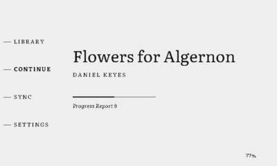

# MarigoldOS

MarigoldOS is a lightweight, open-source firmware for the Xteink X4 and X3 e-readers.

[](docs/FLASHING.md)
[](docs/CUSTOM_FONTS.md)
[](docs/ARCHITECTURE.md)
[](docs/DEVELOPMENT.md)



If you'd like to explore the OS without flashing a device,
[try the emulator](https://jon-vii.github.io/marigold-os/) in your browser. It
runs the firmware's own app and rendering code, compiled to WebAssembly, on a
simulated e-ink display with a few public-domain books.

## Features

### Reading
- EPUB 2 and 3, with each book's own table of contents (EPUB 3 nav, or the NCX as a fallback)
- PNG and JPEG images, dithered for the panel, including small ones set inside a line of text
- Literata and Merriweather, plus a slot for your own typeface from the SD card
- Books are paginated once and cached, so they reopen in tens of milliseconds

### Library and sync
- The catalog streams from the card, so RAM doesn't limit how many books you can have
- Upload, list and delete books from your browser over local Wi-Fi
- With no saved network, the reader opens its own hotspot with a captive portal and shows a QR code to join it

## Development

Prerequisites: install Rust with `rustup`, then install the firmware target and
release-image tool:

```sh
rustup target add riscv32imc-unknown-none-elf
cargo install espflash
```

```sh
tools/cargo.sh run -p fw --release                              # build, flash, serial monitor
tools/cargo.sh test -p app-core -p proto --target aarch64-apple-darwin
cargo run --manifest-path tools/emulator/Cargo.toml --target aarch64-apple-darwin \
  --no-default-features -- --scenario fixtures/scenarios --check fixtures/golden
tools/bench/bench.py channel-stress --host                       # host bench
```

Only flashing needs the device on USB; the app logic, parsers, renderer, and
emulator all build and test on a plain host. `rust-toolchain.toml` pins the
compiler version.

[docs/DEVELOPMENT.md](docs/DEVELOPMENT.md) has the full check CI runs and how to
regenerate golden frames. Hardware bench runs live in
[`tools/bench`](tools/bench/README.md). Use short `page-turn` and
`sleep-sync` runs before trusting flashed builds after display, input, sleep,
reader rendering, SD/cache, or progress-write changes; use longer soak/storage
runs before risky merges or releases.

## Flashing

`cargo run` flashes over USB for development. To install without a toolchain,
from a built image or onto a unit that shipped with USB flashing disabled, use
the app and SD images published with each tagged release.
[docs/FLASHING.md](docs/FLASHING.md) covers the three ways in: the web flasher,
the SD card, and the in-app update from the card.

## Credits

- [Literata](https://github.com/googlefonts/literata) and [Merriweather](https://github.com/SorkinType/Merriweather) (both OFL) for the reading typefaces
- [The OpenX4 community SDK](https://github.com/open-x4-epaper/community-sdk) for panel addressing behavior
- [Crosspoint Reader](https://github.com/crosspoint-reader/crosspoint-reader) for the community reverse-engineering behind X3 device support

## License

MIT
