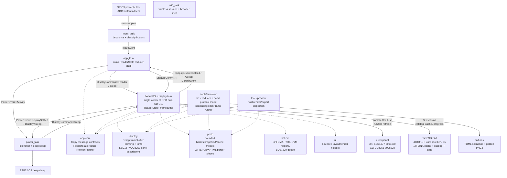

# MarigoldOS architecture

This firmware is a bare-metal Rust reader OS for the Xteink X4 and X3 e-ink
readers: ESP32-C3, monochrome e-paper panels, no PSRAM.

It makes no attempt to imitate a desktop OS. The design is a small data
pipeline:

```text
buttons -> app state -> display command -> framebuffer -> panel RAM -> refresh -> sleep
```

## Architecture diagram



## Rules

- `#![no_std]`, and no heap allocation in the reading path. The wireless
  session is the one exception: it donates loaned buffers to esp-alloc and
  ends in a reset (see "Wireless session").
- Two 1 bpp framebuffers. Views draw into one. The other keeps the previous
  frame for fast refreshes to diff against and lives at the top of dram2
  (`fw::sync_mem`, placed by `fw/build.rs`). Each is 48 KB on the X4 (52 KB on
  the X3).
- Only `display_task` touches the EPD bus. Display ownership has a single
  writer.
- Only `app_task` mutates page/menu state. Reader state ownership has a single
  writer.
- Messages are small `Copy` values. Bulk bytes stay in caller-owned buffers.
- Power asks for display sleep through `display_task` and never touches SPI.
- Hardware assumptions live in a few places:
  - Board wiring (X4 and X3) in `fw/src/main.rs` and `fw/src/tasks/input.rs`.
  - Panel-controller descriptions in `display/src/epd/`: `ssd1677.rs` (X4) and
    `uc8253.rs` (X3), selected at compile time by the `device-x3` feature.
  - Panel refresh flows in `fw/src/display_flush/`.

## Workspace

```text
app-core/ app state reducer and Copy message contracts shared by firmware/tools
display/   framebuffer, drawing primitives, fonts, SSD1677 (X4) and UC8253 (X3)
           panel descriptions
hal-ext/   thin async wrappers over ESP HAL peripherals
fw/        boot, Embassy executor, task wiring, board-owned peripherals
           (esp-hal 1.1, esp-rtos, and esp-radio, pinned in fw/Cargo.toml)
ui/        shared shell rendering plus ui::reading, the reader page-plan seam
           (page bounds, ink measurement, wrapping) used by fw and host tools
proto/     bounded book/storage/text/cache models plus ZIP/EPUB/XHTML parser pieces,
           and book images (proto::image: the IMAGES.BIN index, image paths,
           image tokens, streaming PNG and JPEG decode, dithering)
tools/emulator/ host-side development emulator and scenario runner
tools/cargo.sh  rustup Cargo wrapper on the toolchain pinned in rust-toolchain.toml
tools/bench/    serial bench harness for hardware timing, storage/cache,
                sleep, soak, and host channel-stress checks
```

## Embassy tasks

```text
app_task
  owns ReaderState
  InputEvent -> DisplayCommand::Render
  views (AppView): Home, Library, Reading, Chapters, Wireless, Settings,
  FirmwareUpdate

board_io/display task
  owns EpdBus, SD CS, ReaderStore, and Framebuffer
  DisplayCommand::Render -> pure framebuffer render from the current ReaderStore snapshot
  StorageCommand::* -> serialized SD/FAT/catalog/cache work on the shared SPI bus
  DisplayCommand::Sleep -> sleep screen full refresh -> panel deep sleep -> PowerEvent::DisplayAsleep
  sends DisplayEvent::Settled to app_task when render completes

input_task
  polls GPIO3 and ADC ladders
  debounced ADC/power edges -> reader Button actions -> InputEvent

power_task
  observes activity and display-settled events
  asks display_task to sleep the panel, then enters ESP32-C3 deep sleep

wifi_task
  parked until SyncCommand::Start arrives from the Wireless screen
  requests StorageCommand::LoanSyncMemory, receives the dismantled EPUB
  scratch as radio heap, joins Wi-Fi in STA mode, reports SyncEvents to
  app_task, then serves the browser shelf page at the device's LAN address
  SyncCommand::Exit (the done press) ends the session with a software reset
```

## Wireless session

The wireless session is one-way and modal. The radio blob needs ~100 KB of
heap, and the firmware doesn't have that to spare while reading.
`fw::sync_mem` owns the plumbing. The display task dismantles the EPUB scratch
into raw regions (`reader_cache::dismantle_scratch`), and the wifi task donates
two of them to esp-alloc as heap. The smaller scratch buffers are reused
directly as TCP socket and HTTP buffers. dram2 (the boot-loader shadow
segment) holds only the previous-frame framebuffer, packed against its top so
the radio's static demand fits in main DRAM. `fw/build.rs` hands the gap
beneath it to the main stack, and the trimmed `ControllerConfig` in
`fw/src/tasks/wifi.rs` keeps the radio within the smaller heap. Once the memory
is loaned, the reader pipeline can't come back. Leaving the Wireless screen
after the radio ran maps to `SyncCommand::Exit`, which is a software reset, and
boot restore then reloads the saved position.

Before the loan, the display task flushes any coalesced reading position to
the state record (STATEA/STATEB), because the reset is the session's only exit.
An earlier version also exchanged the position with a kosync server at this
point. That shipped unused and was removed, so the session now only serves
books.

Once joined, the wifi task serves a shelf page at the device's LAN address.
The Wireless screen's `Serving` status shows the URL, with Confirm as the done
key. The page lists the catalog, shows real upload progress, and can remove
individual books. Routes: `GET /` serves the page, `GET /list` returns the
catalog snapshot shipped with the loan, `POST /upload?name=` streams raw EPUB
bytes, and `POST /delete?name=` removes a book (card-root entries carry
`root=1`; uploads always land in /BOOKS).

Upload bytes reach the display task, which is still the single SD owner,
through `fw::upload`'s two-buffer ping-pong. 4 KB chunks carry loaned buffers
one way, and the buffers come back on a return channel once written. The
display task holds one interruptible SD session for the upload phase. It
writes a standard VFAT long name such as `/BOOKS/Original Name.epub`, backed by
a deterministic, collision-safe `.EPU` short alias. An existing long name is
rejected without opening or truncating the original, and an alias collision
probes another alias instead of overwriting an unrelated file. Legacy
short-only `.EPU` uploads and their `/XTEINK/LABELS` sidecars are still
readable. Power/idle sleep and the done press abort an active writer, reclaim
the incomplete file's FAT chain, and close the SD session before sleeping or
resetting. New books show up on the boot rescan.

Station credentials come from alternating `/XTEINK/WIFIA.BIN`/`WIFIB.BIN`
generations, written by the onboarding portal described below (a legacy
`WIFI.BIN` is still read). Dev builds fall back to compile-time `option_env!`
values (`XTEINK_WIFI_SSID`/`XTEINK_WIFI_PASS`). At boot the display task reads
the saved credentials once and reports the saved network's name as
`SyncEvent::NetworkSaved`. The Wireless screen uses that to show which network
is saved and to offer connect/forget honestly, instead of guessing from build
flags. Forget takes two presses: the browse key arms it, then Confirm deletes
both generations and any legacy `WIFI.BIN` via
`StorageCommand::ForgetWifiCredentials`. It is only reachable while the radio
is untouched, and it drops the screen back to the set-up offer. That is the
recovery path for a wrong password or a changed router, which used to mean
editing the card on a computer.

With no credentials anywhere, starting a session raises the onboarding portal
instead. The portal is an open `XTEINK-X4` hotspot at 192.168.4.1 with a
captive DHCP server, a DNS catch-all, and a credential form on port 80. Every
name resolves to the portal, which makes phones raise their sign-in sheet
unprompted. The Wireless screen shows a join QR baked in at build time
(`tools/generate_qr.py`). Submitted credentials travel to the display task as a
`StoreWifiCredentials` Copy message and land on the card, and the next session
joins as a station. `proto::captive` holds the sans-IO DHCP/DNS/HTTP codecs
under host tests; the wifi task only owns sockets.

## Waits, sleep and storage

Embassy handles cooperative waits. ADC retry delays, button polling, SPI DMA
transfers, BUSY waits, and sleep windows all yield instead of spinning. The
real battery saving comes after the display settles: the power task asks the
display task to draw a visible sleep screen and power down the panel, then
moves the ESP32-C3 into deep sleep. The power button requests this same sleep
path rather than being treated as ordinary navigation input.

Input/render backpressure is coalesced on purpose. The app keeps at most one
display render in flight. While the display is refreshing, new button events
still update `ReaderState`, but they set a single pending-render flag instead
of queuing stale framebuffer renders. When `DisplayEvent::Settled` arrives,
the app renders the latest state once.

Storage is explicit too. Files/Home/Reading transitions enqueue
`StorageCommand`s, and render commands never scan FAT, open EPUBs, build
caches, or write progress. Open/extend requests whose page already sits inside
the loaded section window are answered from RAM without an SD session. Page
turns keep the current panel image until the storage reply, then render the
requested page once. A section already in the book index, whether complete or
a prepared prefix, needs only a cache read and never shows a loading plate.

Reading-progress writes are coalesced. Same-book page turns write at most one
alternating STATEA/STATEB generation per 15 s. A coalesced position is written
when its window ends even if no further page turn comes, so a battery pull
loses at most 15 s. Book, chapter, and layout changes write immediately. A
pending position is also written before display sleep, a Wi-Fi memory loan, a
firmware stage, and a switch to another book. A failed write retries every
30 s. These rules all live in one owner, `ProgressJournal` in the display task.

Sleep always completes. The display task writes the pending position (one
retry), paints the sleep image, powers the panel down, and answers
`DisplayAsleep` even if the write, the refresh, or the power-down failed.
Staying awake after a failure only drained the battery, and wake is a reboot
that re-initialises the panel. The power task still deep-sleeps if no answer
arrives within 120 s.

The board I/O task is still the single SPI owner, so display refresh and SD
transactions can't overlap, but the user-facing view is always drawn from the
latest snapshot the task already owns. SD/FAT access goes through an SD
session. The board I/O task deselects the display, clocks the bus down for the
card (400 kHz identification with wake clocks, then 20 MHz data), opens the
FAT root, performs one storage action, and restores 40 MHz display SPI before
going back to EPD work. The card stays powered between sessions while the
device is awake, so only the first session runs the full CMD0/ACMD41 init.
Later sessions reuse the remembered card type and skip the handshake, falling
back to a cold init if a reused session can't open the volume. Deep sleep
resets the chip and clears that state.

Settings also has a native firmware-file list. Opening it issues a storage
command that scans root-level `.BIN` files into the reader store. After the
second confirmation, the display task draws the visible update handoff, writes
the selected file's FAT alias to `/XTEINK/FWPEND.BIN`, and resets. Boot
reopens that exact source through the existing whole-image validator and
inactive-slot updater. The updater reads the installed ESP-IDF partition table
before it erases anything, because stock X3 units and Marigold/CrossPoint
installations put `ota_1` at different offsets. The source file stays on the
card, so several firmware images can coexist.

## Display model

`display::fb::Framebuffer` is the source of truth. White is bit `1`, black is
bit `0`, row-major, `ROW_BYTES` per row (100 on the X4, 99 on the X3). Each
framebuffer also carries its `FbFrame`, the drawing frame for how the device
is held (see orientation below). Rules draw pixel by pixel. Glyphs, built-in
or from a custom font pack, draw a row at a time through `fb::GlyphPainter`:
a few masked byte stores per row in the landscape frames (mirrored through
the bit-reversal table when flipped), and 8 × 8 bit transposes in portrait. A
glyph that hangs off the frame falls back to `set_pixel`, clipped as before.
Either way the painter leaves exactly what a `set_pixel` per ink pixel would.
`Framebuffer::blit` draws a band of an image's 1 bpp rows, in the image pack
layout, a byte at a time. In the landscape frames it shifts whole rows into
place (bit-reversed through the panel transform's table when flipped), and in
portrait it does 8 × 8 bit transposes. It leaves exactly what a `set_pixel`
per pixel would, clipping included.

On the X4, the SSD1677 path writes the current framebuffer to BW RAM
(`0x24`). The first refresh after boot also writes the current framebuffer to
RED RAM (`0x26`) and runs the multi-flash full waveform (~3.5 s), the only mode
that reliably clears unknown pixels. Normal page turns use a second, retained
framebuffer as the RED RAM previous-frame source, then trigger the SSD1677
fast waveform (~421 ms).

`RefreshMode::FastClean` sits between those two: a clean with one flicker. On
the SSD1677 it runs the display-mode-1 waveform with the temperature register
overridden to 90 C, which selects the hotter (shorter) OTP LUT. That cleans up
ghosting in ~1.5 s at a small cost in contrast. Waking from the sleep screen
and view/context changes use it instead of the full waveform, since the
panel's contents are known. After a FastClean settles, the update sequence
reloads the sensed temperature so later fast refreshes go back to
sensor-accurate timing.

The X3's UC8253 has two RAM planes (DTM1 "old", DTM2 "new") instead of BW/RED,
and its waveform LUTs are uploaded per refresh. Each `RefreshMode` therefore
maps to a LUT bank plus a CDI mode byte, and FastClean is a half-scrub LUT bank
(see `display/src/epd/uc8253.rs`).

The user-facing `RefreshPolicy` in Settings chooses between `FastOnly` (the
default), `FullOnWake`, and `FullEveryTen` (shown as "clean every ten").
Under `FullEveryTen`, once `DEFAULT_FULL_REFRESH_INTERVAL` (9) consecutive fast
refreshes have built up, the refresh planner schedules a cleaning refresh
(FastClean) for the tenth page instead of another fast one. Deep sleep reboots
the chip, so the planner itself doesn't survive it. `fw::wake_mark` keeps the
one fact that matters in the RTC STORE0 retention register (RTC fast memory is
powered down in deep sleep). The display task sets it when the sleep screen
finishes and consumes it at boot, trusting it only when the reset reason is a
deep-sleep wake. A marked wake seeds the planner as if it had just slept, so
the first paint takes FastClean; `FullOnWake` keeps the deep Full there. A
cold boot, a reset for any other reason, or a sleep whose screen failed paints
with Full.

`display::epd::ssd1677` has three transform constants, as validated during
bring-up: `MIRROR_X = true`, `MIRROR_Y = false`, and `REVERSE_BITS = true`.
The logical framebuffer API stays upright, and firmware and host tools remap
bytes/bits before writing panel RAM. This corrects the X4 panel's observed
horizontal byte order and bit order without leaking hardware orientation into
app rendering. `MIRROR_Y=true` was tested and rejected because it mirrored
glyphs vertically (upside down).

Physical orientation belongs to the app and layout code; panel streaming
doesn't know about it. The reader state carries a four-variant orientation
enum:

```rust
enum DisplayOrientation {
    LandscapeButtonsBottom,
    LandscapeButtonsTop,
    PortraitButtonsLeft,
    PortraitButtonsRight,
}
```

The default reader mode is `LandscapeButtonsBottom`. Settings cycles three
holds: the two landscapes and `PortraitButtonsLeft` (front buttons below the
screen). `PortraitButtonsRight` stays in the enum for the persistence format
and renders like `PortraitButtonsLeft`. Renderers draw through
`display::fb::FbFrame` (`Landscape`, `LandscapeFlipped`, `Portrait`, or
`Native` for boot and byte-level tooling). `set_pixel`/`pixel` take upright
coordinates in the held frame and map them onto the panel's native row-major
buffer, folding in the panel's inverted row scan. The low-level display
transform above should stay fixed unless corruption comes back.

X4 (SSD1677) addressing follows the behavior of the OpenX4 community SDK:

- SPI mode 0, 40 MHz.
- BUSY is active high.
- X window is pixel-addressed, `0..799`.
- Y gate scan is reversed, so the full Y window is `479..0`.

## Data-oriented design

State is plain data rather than object graphs:

```text
InputEvent        Copy enum
ReaderState       view/book/page/chapter/settings/battery fields
RenderRequest     view/book/page/orientation/refresh/battery/dirty rect
Layout<N>         parallel arrays of kind/rect/parent/text span
Framebuffer       flat byte array plus its drawing frame (FbFrame)
```

`app-core` owns the reader reducer and the shared message contracts. The
firmware `app_task` is an Embassy shell around this pure reducer, and host
tools use the same reducer for deterministic navigation tests. That keeps
button flow, library events, restore events, orientation, refresh policy, and
render requests from drifting apart between device and emulator.

EPUB work has the same shape:

```text
SD file -> ZIP entry -> inflate window -> XML token -> flat cache record -> glyph blit
```

There is no DOM, no heap object graph, and no reader model that holds the
whole book in RAM. Parsers can be state machines, but their output is
flattened into bounded records straight away.

`proto` owns the reader data contracts shared by Home, Files, Reading,
Chapters, and the host preview tool:

- `BookMeta`, `BookProgress`, and `ChapterMeta` for catalog and progress data.
- `BookStorage` and `FileCandidate` for microSD-backed `.epub` discovery.
- `ZipArchive` for host-side central-directory lookup and stored/deflated entry
  reads into caller-owned buffers.
- `ZipStream` for central-directory lookup and entry reads through a bounded
  `ReadAt` interface. Storage-backed EPUBs use this path. Firmware ZIP reads
  stream deflate input through a reusable inflater scratch state, so large
  compressed members don't have to fit in the compressed scratch buffer.
- `EpubZipOps`, the narrow zip-entry interface that cache loaders program
  against. Both zip front-ends implement it, with one shared streaming inflate
  engine behind them, so entry reads behave the same whether the compressed
  bytes come from random-access or forward-only storage.
- `EpubPackage` for OPF metadata, nav/NCX/cover hrefs, and the spine.
  `parse_opf_streamed` reads a package document of any size in two streamed
  passes and copies only the strings the package needs into a 16 KB arena.
  The first pass lays out one 8-byte slot per spine itemref at the top of the
  arena, holding a 48-bit hash of its idref. The second pass fills each slot in
  place as the manifest item with that id streams past (its href span and
  interned media type and properties), so neither manifest ids nor a spine
  table touch the stack. `EpubPackage::spine` is a `Spine` view over those
  slots. A spine longer than `MAX_SPINE_ITEMS` (1,024), or one whose hrefs
  exhaust the arena, marks the package `spine_truncated`, and the book's last
  page says it was cut short.
- `xhtml_blocks_to_sink` with `TextRole`, `FontStyle`, and `TextAlign`, the
  single XHTML extraction path feeding bounded block records. Images reach
  the sink through `XhtmlBlockSink::push_image` as raw `src`/`alt` slices
  (and, for a sink that asks, the first `<image>` of each `<svg>`); the
  default pushes the alt-text placeholder. The parser ends the paragraph
  before an `` unless the sink `wants_inline_images`. In that case it
  ends only the open run, the image belongs to the paragraph, and an image in
  a left-floated block goes to `push_floated_image`.
- `proto::image` for images in books:
  - `path` resolves an image `src` against its chapter's ZIP path and hashes
    it.
  - `index` owns the per-book `IMAGES.BIN` format (entries from the ZIP
    central directory, sorted by path hash, with probed and decoded state
    filled in place).
  - `token` is the text an image block stores, and the 15-byte token (U+FFFC,
    slot, width, height) a line carries for each image inside it.
  - `pack` is the record a decoded image keeps in its orientation's pack.
  - `png` and `jpeg` decode an image, fed in pieces of any size, to gray rows
    at the size layout fitted (`jpeg` at a reduced DCT scale where that still
    covers it, luma only).

  An image block is a `BlockRecord` whose `image_height` (the record's last
  two bytes, zero in caches before v28) is non-zero and under
  `BlockRecord::INLINE_IMAGES` (0x8000). A line holding images has that bit
  set and its tallest image's height in the low bits. `ui::reading` fits block
  images with `fit_image` and inline ones with `fit_inline_image` (at most 64
  rows, `INLINE_IMAGE_MAX_HEIGHT`, whatever the type settings). It gives a
  block image gaps above and below so the neighbouring lines' descenders and
  tallest marks clear it by a row, and grows a line holding images by the
  same gaps (`inline_line_ascent`), with each image standing on its baseline.
  It then hands every image's rect to the page's image drawer.
- `hyphen::word_breaks` for where a word may break at a line end: the book's
  soft hyphens (the only breaks when present), dashes already in a compound,
  and for English (`dc:language` `en*`), Liang's algorithm over the US English
  TeX patterns (hyph-utf8, generated into flash by
  `tools/generate_hyphenation.py` as a trie whose first two levels are direct
  tables). Two letters stay before a pattern break and three after. Short
  words, acronyms, and words with digits or accents stay whole.
- `BookV2Header` with `BookV2SectionRecord`, and `SectionV2Header` with
  `PageRecord`, `BlockRecord`, and `TocRecord`, for the bounded binary cache
  records the firmware reads and writes. The earlier `BookCacheHeader`,
  `SectionHeader`, `PageCacheHeader`, `LineRecord`, and `WordRecord` remain in
  `proto::cache` only for the disabled V1 migration path.

The firmware's line builder (`fw::block_sink`, the XHTML block sink a spine's
layout streams into) wraps greedily at word spaces. When a word no longer fits
a justified body line, `ui::reading::worth_hyphenating` decides whether moving
it would leave the line loose: each gap growing by more than half a space, or
after two hyphenated lines in a row, by more than a whole space. If so, the
line takes the longest head of the word that fits, with a hyphen. The word is
measured glyph by glyph first (those tables stay cached, since every word is
measured). The patterns, which are cold by the time a line ends, are consulted
only if a two-letter head fits, and only for the head that does. On X4 that
holds hyphenation to about a fifth more time on a cold book build (Death in
Venice: 18.9 s without, 24.6 s with), and idle-time preparation (see the reader
cache) keeps most of it off the open. A paragraph's last word is never split,
and a word wider than a whole line breaks wherever it can. At draw time,
`justify_extra` leaves a line at natural spacing rather than open gaps past
two spaces, and does the same for lines under two thirds of the measure. Soft hyphens survive normalisation as break hints and are stripped
from stored lines. An image inside a line is one unit of its fitted width,
measured as an object (`StyledInkCursor::push_object`) and never split or
hyphenated. Justified gaps stretch around it as they do around a word.

Greedy lines are kept unless one goes wrong. The builder also keeps the
words of a justified paragraph's last few lines in `fw::line_window`, each
measured once as it is placed (`ui::reading::InkPiece`, which the line's
own measure is then built from), with a record of where each stored line
starts. A line the page would leave ragged, or a third hyphenated line in a
row, is repaired once two more lines follow it: the builder takes back the
stored lines from three before it (`ReaderStore::truncate_lines`), and a
total-fit search (Knuth and Plass's, without fitness classes) breaks their
words again with the line in hand, which stays in hand for the words to
come. The search judges each line as the page will set it
(`justify_extra`): TeX's badness of 100 r³ for gaps stretched r
half-spaces, and for a line left ragged a premium over any justified one
that grows with its shortfall and triples under two thirds of the measure.
Hyphens cost a little, a hyphen after another a lot. A word is looked up
only where it straddles the end of a line that would be loose without it,
and lookups, the builder's and the search's, share a cache of break
positions that lasts the spine. Lines the search stored are not taken back
again but for the last. On eight Project Gutenberg books, lines left ragged
fall from 6.9 to 4.2 in a thousand at the default type (portrait 102 to
72), with about 32 repairs per thousand lines (portrait 156). The window
(9 KB) is the idle tail of the XHTML window while a spine streams.

All of this applies to text the book sets justified, which is the body
default. The Alignment setting's Left choice turns that text left-aligned
before the line builder sees it (`ui::reading::effective_align`). The text then
keeps words whole, draws at natural spacing, and builds without the pattern
lookups. Centred text keeps its own alignment either way. Alignment is part of
the reader layout config (bit 15, zero for justified), so switching it
rebuilds books, and caches built before the setting existed stay valid under
Justified.

The firmware still ships one built-in catalog entry as a fallback. The board
I/O task owns the shared SPI bus while it scans FAT16/FAT32 microSD cards for
EPUBs under `/books` and then the card root. X4 SD pins are configured on the
shared SPI bus (SCK GPIO8, MOSI GPIO10, MISO GPIO7, SD CS GPIO12). That single
board-I/O owner keeps SD transactions and display refreshes serialized.

## SD-backed reader cache

The SD reader shows a book as soon as its V2 cache reaches the requested page,
and prepares the rest while the reader is idle. Preparation runs in sessions.
Each session opens the package once (ZIP, container, OPF) and lays out spine
items one after another, writing section files as they fill. It stops when the
request is answered, a button is pressed, the book is done, or four seconds
have passed. The book index (a few dozen block writes) is written as the
session ends and every 1.5 s within it, so a press mid-spine loses at most the
spines since the last write. The loading plate stays up only until the cache
holds the requested page (or chapter, or the text start of a first open), and
the store is then Ready.

Between sessions the board I/O task keeps only the request and a durable
next-spine cursor, and yields so queued navigation, sleep, and cancellation can
run. A request generation rejects stale work and results after the reader
leaves the book or changes its layout. Within a session a request yields
between spines on a button press, but a large XHTML spine still blocks the
shared I/O owner until its stream finishes.

Page numbers are global, so every spine before a page fixes that page's
number. Some requests name a spine well ahead of the prepared prefix: a relaid
book's pinned place, a chapter jump, a first open's text start. These don't
wait for the spines in between. When at least 64 KB of XHTML lies in between,
the requested spine is laid out first into a seed run, whose pages are
numbered provisionally from `PROVISIONAL_PAGE_BASE` (0xC000; any page from
0x8000 up is provisional while a run exists). The run's records follow the
prefix's in the book index, its sections take ids past both banks, and it
grows toward later requests. The prefix then catches up while the reader is
idle. Layout is per spine, so the prefix lays the seeded spines out the same
way, and a provisional page takes its real number
(`ReaderStore::settled_page`) once the prefix holds its spine. Requests, saved
positions, the reader's page (renumbered by `LibraryEvent::Prepared`), and a
later relayout's page pin all translate through the run, which stays in the
index for that purpose. There is one run per cache generation, since a second
would renumber the first one's pages. A spine behind the run waits for the
prefix, and paging back across the run's start shows the loading plate until
the prefix arrives. Books with a generated (headings) TOC, whose entries follow
spine order, are not seeded.

The display task prepares the rest of a Ready cache when the reader is idle:
no command for two seconds, the page on screen resident in the layout it was
prepared for, and no sync session. Idle sessions extend the prefix, read the
page on screen back, and yield before the next session. They give way at the
next paragraph, or after the OPF parse, once a button press moves
`BUTTON_PRESSES`. The input producers count every press as they queue it, so
the session sees a press the app task hasn't received yet. The spine in hand
when a session gives way or fails is not committed. The card still holds what
was there before, and the session reloads the page on screen from it (about
65 ms), so the press is served promptly. On the X4 a cold build of a
1,276-page book costs about 51 ms a page in sessions, against 61 ms with a
package reopen and index write per spine (October 2026). A spine that fails is
not retried until preparation moves on some other way. Growth reaches the app
as `LibraryEvent::Prepared`, which updates page and chapter counts without a
repaint. A reader who outpaces it reaches the end of the prefix and gets a
request session with the loading plate.

While a next-spine cursor exists, the cached page count is a known prefix, not
the book's total. An unresolved chapter target stays unresolved rather than
aliasing page zero or the last cached section. Appending complete spines
preserves earlier page numbers and chapter boundaries. Reopening can reuse the
committed prefix (and seed run) after sleep or an interrupted session.

The build covers every spine item from the first, front matter included
(navigation documents aside). It also records where the main text starts: the
OPF guide's `text` (or `start`) reference, else the EPUB 3 nav's `bodymatter`
landmark, else a first spine item named for the cover or title page. A book
with no saved position first opens there, provided the start lies in the
book's first quarter. Paging back or the Contents still reach the cover and
foreword. Before layout version 21 the builder dropped everything before that
start instead.

A source spine item can paginate into several sections, and several TOC
chapters can refer to the same spine. The builder closes the current section
and opens the next when its in-RAM arena fills. For prose the text budget
(16 KB) is the binding limit, well ahead of the block (384) and page (96)
caps. Sections are invisible while reading: the reader walks across them
without a break, and the footer page-in-chapter counter aggregates every
section sharing a spine. The book index holds up to `MAX_BOOK_SECTIONS` (1,024
sections, on the order of 14,000 pages of prose). Each spine item takes at
least one section, so this also bounds books made of many short files. In RAM
the index is a `SectionTable` of 4 bytes per section (spine and page count),
since ids run contiguously and each section starts where the last one ended.
The card record keeps all 12 bytes. Builds append to the store's table in
place and index loads fill it directly, so there is one copy. This cap still
applies to the active index. A capacity-limited book becomes terminal and
`partial`, with no continuation cursor. That differs from a resumable prefix,
which has more source spines available and must not present its known pages as
a final total.

Each section header carries a `font_config` that packs `READER_LAYOUT_VERSION`
with the type size and spacing it was paginated under. A loaded section whose
version or size no longer matches is invalid and forces a rebuild, so bumping
`READER_LAYOUT_VERSION` retires every stale cache after a layout or
cache-encoding change. For a complete, non-partial cache, a spacing-only change
streams all cached pre-wrapped lines through the shared page plan and rewrites
the full book into the other section bank, without reparsing EPUB/XHTML. The
section-cut and carry policy is shared with fresh builds. The new index commits
only after every replacement section is written, so an interruption leaves the
previous generation readable. This full-book spacing reflow is synchronous. A
spacing change to an unfinished prefix takes the fresh-build path instead.

Either way the book's page numbers move, so a page number saved or requested
under the old layout would land somewhere else in the text. Before the old
pagination is replaced, the requested page is pinned as a `PageAnchor`: its
spine item, and how far through that spine's pages its middle sat. The spacing
reflow pins it from the resident sections. A rebuild reads the old on-card
index once (`read_v2_page_anchor`, header and section records only) before
building. The pin stays in the `ReaderStore` across the rebuild's steps,
`requested_page` resolves it to the same spot in the new pagination once that
spine is laid out, and the completed load spends it. This covers a type or
orientation change mid-book, and opening a book last read under other
settings.

### Image index

Images get an index of their own. A build session whose ZIP has image entries
opens the book's `IMAGES.BIN` before its first spine, and builds it from the
central directory when there is no valid one (`fw::book_images`). The index
holds PNGs and JPEGs (by extension; the probe goes by magic bytes), and an
index from before JPEGs (version 1) is built again. A fresh build learns
whether there are any images from the ZIP open's own pass over the central
directory, and records that in the book index, where every later session reads
it. Only a directory of more than about 200 entries, too many for that pass's
index, is walked a second time. A directory damaged past the entries a build
looks up counts as having no images, so the book still builds, and a book
without images never touches the index. The compressed scratch and the XHTML
window are idle at that point and lend the build their buffers.

No image is read up front. Each one is probed the first time a chapter's
layout meets it. A spine that meets images no probe has read marks them wanted
in the index and stops laying out at the first one. It probes them from their
stored ZIP offsets and is then laid out again with their fitted sizes. An idle
session's probes give way to a press between images. A probe reads until it
can judge the image (`proto::image::index::ImageProber`): a PNG's first 33
bytes, or a JPEG's segments up to its frame header, which may follow 64 KB of
EXIF. A stored image is read a card block at a time and seeks past every
segment the probe doesn't read. A deflated one is inflated through the idle
inflater and the skipped bytes are dropped. Either way at most 256 KB are read
or inflated, and an image that hasn't identified itself by then is failed. A
probe whose local header is missing, lies past the archive's end, or names
another file marks the image failed for good. A read that fails records
nothing and fails the step, so the image is probed again.

Nothing commits between the two layout passes. The first pass's sections leave
the run's table before the second, and the second rewrites every section file
the first wrote, so the discarded pass leaves nothing behind. Only spines with
newly met images pay for it. An image the decoder doesn't take keeps its
alt-text placeholder; an svg-wrapped image, which never had one, leaves
nothing. The index doesn't depend on type settings, so it survives every
relayout, and it lives in the book's cache directory.

### Inline and block images

An `` whose paragraph also holds text goes inside that paragraph's lines
(`fw::block_sink`). Three kinds stay image blocks: one alone in its paragraph,
every svg image, and every illustration (taller than 128 rows alone in a
paragraph in either orientation, `ui::reading::fits_inline`). An illustration
ends the paragraph around it. For such a sink `<figure>` and `<figcaption>` are
blocks. The parser streams, so an image met before any of its paragraph's text
is held back as a small record in the idle tail of the container scratch (its
slot, both fitted sizes, and its block token or alt text). The paragraph's
first text then places the held images inline ahead of it, and a paragraph
that ends without text sends them out as blocks. Spacing among held images is
held with them, in order, and text the sanitizer drops doesn't count. An
inline image that can't be shown leaves its alt text in the line in italics.

A drop cap that Project Gutenberg floats in a block of its own (class
`figleft`, a single-letter alt) carries into the next paragraph when that
paragraph is body text beginning with a letter, and opens its first line in
place of the indent. A line holding images is justified whenever it fills two
thirds of the measure (`justify_inline_extra`).

An image shown inside a line at a size other than its block size (one taller
than 64 rows) gets the index entry's sticky `inline` mark. From then on it
decodes at its inline size, once per orientation. Wherever the two sizes
differ, a block-size decode it had is forgotten in the same write, and its
block uses draw the smaller decode centred in their box. A page asking for an
unmarked image at its inline size marks it again before decoding.

### Image decoding

Each image is decoded once per orientation, at the size layout fitted it to,
into an append-only pack in the book's cache directory (`IMGL.BIN`, which
flipped landscape shares, and `IMGP.BIN`; `proto::image::pack`,
`fw::image_decode`). A decode reads the image at the local-header offset its
index entry keeps, after checking that the header names it, so no ZIP
directory is opened. A stored image streams from the ZIP through the decoder
for its format and the ditherer. A deflated JPEG streams through the ZIP's
inflater straight into the JPEG decoder, which needs no inflater of its own. A
deflated PNG is first inflated to `SPOOL.TMP` beside the packs and decoded from
there, since the PNG decoder's zlib stream needs the one inflater. The spool is
deleted after each image. A deflated image of either kind larger than 4 MB by
its declared size is refused, as is a stream that outgrows its declared size.

Rows go to the pack behind a 16-byte record header through a write buffer. The
index entry takes the record's offset in one write, and only once the decode
has finished and the pack's length is on the card. A content fault (a corrupt
image, a PNG too wide for the window to hold its row, a damaged entry) marks
that orientation failed for good. A card fault or a spent read budget records
nothing, and a press cancels the image in hand. (An inflate, to the spool or
into the JPEG decoder, checks for a press between pieces of input as well as
between chunks of output.) Either case leaves at most an orphan tail in the
pack that nothing points at.

A pack that would pass its 64 MB cap is mostly orphans when the records its
images use, plus the next one, fill at most half of it. In that case every
decode in that orientation is forgotten in the index, the pack is deleted, and
a new one is begun, so images decode again as they are needed. If the images'
own records fill the pack, the next image fails instead. An index that is
built again (damaged, for another copy of the book, or from before JPEGs)
first deletes both packs and any spool, since nothing in it would point at
their records.

The decoder, the ditherer and the packed row take the XHTML window (along with
a deflated JPEG's inflate output). ZIP reads and the write buffer split the
compressed scratch, work lists take the container scratch, and the inflater
serves a deflated PNG's two layers in turn. All of these are idle outside a
build session, and image work always runs in an SD session of its own, so
decoding adds no static RAM.

Images are decoded nearest the reader first. Layout records in each index
entry where it first met the image: its spine, and how many images that spine
met before it. No relayout changes that. While the reader is idle, each step
does one thing, in this order:

1. The undecoded images on the next three pages and the page before (from the
   store for pages it holds, from their section files otherwise).
2. Text layout, as before.
3. The rest of the book's images, in reading order from the reader's place to
   the end and then on from the start, a batch at a time from one read of the
   index.

Steps keep the session budget. A press stops a decode between output rows (or
between pieces of input, a kilobyte each), the other passes stop between index
entries, and any command from the app looks at the window again. A request for
a page whose images aren't decoded for the orientation decodes them before it
is answered, so a page never shows a box that its picture would later replace.
A press during that wait, or a newer request, abandons the image in hand. The
request is then retried for the page it resolved to (a first open's text
start, a relaid page's place) unless a newer one replaces it.

The store keeps a note of what is settled (decoded or failed) for the
orientation: `ReaderStore::images_settled`, five bytes found by narrowing two
counters. It covers a run of pages that a request or a window pass found
settled and, once a rest pass finds nothing left in the index, the whole book.
A request for a noted page answers without opening the card to check. An idle
step opens no image session for a window the note covers, or at all once the
book is settled, so a fully decoded book reads nothing after a page turn
beyond its pages' draws. Decode state only moves toward settled until the
index is rebuilt. The note therefore lasts until the book, its layout or its
index changes, or a fresh build numbers its pages anew. A spine being laid out
keeps the pages' note but unsettles the book. A book without images, or a page
without images, does none of this and reads nothing extra. A page's images
include those inside its lines, found by walking their tokens (in the store,
or in a section file's line text 64 bytes at a time). An orientation change
decodes into the other pack as its pages are requested and idle steps reach
them. A change of type settings decodes nothing again.

Caches from before image blocks (v27) are still read. The first load of such a
book's index reads its ZIP's central directory once. If there are no PNGs or
JPEGs beyond a lone image whose file name says `cover`, the index is written
again as the current version (v30), unchanged, and the cover page keeps its v27
layout until a fresh build shows it. With any other image, the book rebuilds,
pinned to the reader's place, so its images replace the alt text it was laid
out with. v28 and v29 caches, which only development builds wrote before
images went inside lines and before JPEGs, rebuild.

### Drawing images

A reading page draws its images from the book's packs (`fw::page_images`).
Pages draw from RAM outside any SD session, as before, unless the book has
images and the page holds an image block or a line with images in it. Such a
page is drawn inside a session, the same way a page in a custom face from the
card is. For each image the page reads its index entry and, if the image is
decoded for the orientation, its pack record's header. It draws a record only
if the record is the image the page names, no larger than the rect layout
reserved, and lies inside the pack. (A block whose image is also shown inside a
line draws its smaller decode centred.) An inline image that can't be drawn
shows the outline of its rect. The rows stream from the card a band at a time
through the panel transfer band into `Framebuffer::blit`, never reading past
the record. Only panel transfers fill that band, so it is idle while a frame
draws. Anything else draws the alt-text placeholder. A card error part way
through clears the rows drawn, and the page's later images draw placeholders
without reading. If the session can't open, the page is drawn from RAM with
placeholders and is never left showing the previous frame. Each page that
draws images logs `bench: image_draw` with its image and placeholder counts,
row bytes, and time spent opening, reading and blitting.

### Catalog and cache files

Cache paths use FAT 8.3-safe names because `embedded-sdmmc` works on short file
names in the firmware path. The library list is a windowed catalog snapshot at
`/XTEINK/CATALOG.BIN` (v4: `X4CT` magic, u16 book count, 92-byte records).
Firmware streams it `LIBRARY_WINDOW` (16) entries at a time instead of holding
the whole list in RAM, so library size is bounded by the card, and only window
crossings re-read it. The open book sits in a separate `active_entry`, so the
reading path never depends on where the list is scrolled.

On boot/refresh, firmware first loads a window from the cached snapshot, then
refreshes `/BOOKS` and card-root discovery in a storage command, streaming the
fresh catalog out in batches without ever holding it whole. Entries are
labeled with the book's real title from its cached index, falling back to the
stored original-filename label for uploaded 8.3-named books, then to the
prettified file stem. This advisory title lookup tries a source-matching
legacy `BOOK.BIN` first, to avoid probing absent generation files for every
old catalog entry. Page totals and section loading keep generation selection.
Each fresh catalog write also sweeps `CACHE2` and reclaims caches whose stored
source identity no longer matches any catalogued book. It deletes the data
files and the emptied directories and leaves the global state record alone.

Files renders the current snapshot immediately. Until a snapshot or scan
result arrives it shows “reading the card…”. It shows “the library is
unavailable” when a scan fails with no snapshot to fall back on, and a
“no books” note asking for EPUB files in `/books` when the snapshot or a
completed scan has none.

```text
/XTEINK/CACHE2/E<hash>/BOOKA.BIN
/XTEINK/CACHE2/E<hash>/BOOKB.BIN
/XTEINK/CACHE2/E<hash>/BOOK.BIN       (legacy fallback)
/XTEINK/CACHE2/E<hash>/TOC.BIN
/XTEINK/CACHE2/E<hash>/COVER.BIN
/XTEINK/CACHE2/E<hash>/IMAGES.BIN     (books with images)
/XTEINK/CACHE2/E<hash>/IMGL.BIN       (decoded images, landscape; IMGP.BIN portrait)
/XTEINK/CACHE2/E<hash>/SPOOL.TMP      (a deflated PNG while it decodes)
/XTEINK/CACHE2/E<hash>/SECTIONS/S000.BIN
/XTEINK/CACHE2/E<hash>/SECTIONS/S001.BIN
/XTEINK/CACHE2/E<hash>/POSA.BIN       (per-book position, alternating with POSB.BIN)
/XTEINK/CATALOG.BIN
/XTEINK/LABELS/<stem>.TXT
/XTEINK/STATEA.BIN
/XTEINK/STATEB.BIN
/XTEINK/STATE.BIN                     (legacy fallback)
```

Each book index holds a `BookV2Header`, one `BookV2SectionRecord` per section
(spine, start page, page count, partial), TOC records, and title/author/TOC
text. The header also records the optional next-spine cursor, whether the TOC
was generated from content, and the text-start spine (in two formerly reserved
bytes, so older indexes read as "unknown"). `BOOKA.BIN` and `BOOKB.BIN` add a
generation/checksum footer that is written last. Loading verifies the newest
committed body and can fall back to the older valid generation or the legacy
index.

Section IDs use two banks, 0–1023 and 1024–2047 (files `S000.BIN` to
`S2047.BIN`). A fresh build or spacing reflow uses the opposite bank. Before
overwriting it, firmware retires older indexes that reference that bank while
keeping the active generation. Continuation steps append unused IDs in the
current bank. An interrupted replacement therefore can't leave a fallback
index pointing into partially overwritten sections. The two banks give
recovery space; they don't double the active-section limit.

Section files hold a `SectionV2Header`, page records, block records, per-block
paragraph flags, and the UTF-8 text blob of pre-wrapped lines. A line carries a
style marker only where its style changes, and opens in Regular unless a marker
leads it (`ui::reading::line_opening_style`). A block record's style applies
only to a line without markers. `TOC.BIN` is a per-book chapter-list sidecar
for the Chapters overview, separate from the records inside the book index.
Generated TOC metadata is carried across prefix commits, and a missing or
stale sidecar can be repaired from the committed index.

The active firmware state keeps only the loaded book metadata, the full section
index, the active section's page/block records and text bytes, and small
ZIP/XML scratch buffers. Spine XHTML members of any size stream completely
through the resumable block parser in bounded inflate windows, so
scratch-buffer limits never truncate chapter content. The global state record
(alternating `STATEA.BIN`/`STATEB.BIN` generations, with a legacy `STATE.BIN`
still read) stores the encoded `AppStateRecord`. Records from version 2 on
include the SD source size and path-derived hash, so boot restore can map
saved progress back onto the scanned SD catalog instead of trusting a volatile
list index. The current version 4 also persists the type settings (size,
spacing, weight, and family) and the front-button order.

`COVER.BIN` is an optional Home-cover sidecar for the same cache key. It stores
a tiny header followed by a 202x303, 1-bit, row-packed bitmap matching the Dock
Clean cover slot. Firmware still loads a valid record into the reader store as
flat DOD data, but the current Home title page doesn't draw it. The host
preview tool can generate the sidecar from EPUB JPEG/PNG covers with
`--cover-bin`, or write it directly to a mounted SD cache path with
`--sd-root`.

Reading and chapter navigation typography use generated bitmap assets for two
OFL faces, Literata (the default) and Merriweather, plus an optional SD-card
custom font pack (`docs/CUSTOM_FONTS.md`). `tools/generate_literata.py`
downloads the Literata TTFs and emits glyph metrics and bitmaps for Regular,
Italic, Bold, and BoldItalic, covering the ranges in its `RANGES` table: Basic
Latin, Latin-1, Latin Extended-A/B and Additional, Greek, Cyrillic, general
punctuation, currency and letterlike symbols, arrows, and geometric shapes.
Firmware doesn't rasterize TTFs on-device.

The generated modules hold `display::font::BitmapFont` tables, laid out for
flash rather than for the generator. Codepoint ranges map a codepoint to its
glyph slot. A presence bitmap marks the slots a face lacks, which all draw
its missing-glyph box and share one entry (about 40% of the reading faces'
slots). Glyph entries are 8 bytes. Each distinct glyph bitmap is stored once,
with a row that repeats the row above folded into one bit. Kerning pairs are
grouped by left glyph at 2 bytes each. `tools/fontgen_common.py` pins Pillow's
BASIC layout, whose hinted whole-pixel advances the tables carry, and
`tools/generate_merriweather.py` carries U+2116 over from the checked-in table,
because a FreeType that can load HarfBuzz autohints that one glyph
differently.

## Development emulator

`tools/emulator` is a host-side parity tool for fast development loops. It has
a headless scenario runner for agents/CI and an optional egui frontend for
manual interactive testing. The default build is headless. The desktop window
needs `--features gui`, which keeps routine checks light.

The emulator models what is useful during ordinary development:

- app reducer state transitions from button and library events
- selected-panel 1 bpp framebuffer rendering (X4 800x480 or X3 792x528)
- shared panel byte/bit transform from `display::epd`
- SSD1677-style BW/RED RAM, address counters/ranges, refresh mode history, and
  deep-sleep command validation
- UC8253 DTM1/DTM2, LUT/CDI, prestage, power, and sleep validation driven by
  the same allocation-free refresh-operation plan as firmware
- scripted scenarios that can assert final view/book/page/selection/panel state,
  dump PNG frames, and compare against golden frames

It doesn't model ESP32-C3 CPU timing, ADC noise, SPI DMA edge cases, BUSY
timings, voltage/temperature behavior, or real e-paper waveform physics. Those
still need validating on hardware.

## Development bench

`tools/bench/bench.py` is the hardware-facing counterpart to the emulator. It
captures serial output with the same DTR/RTS behavior as
`tools/serial_capture.py`, parses structured `bench:` telemetry, writes JSONL
logs under `target/bench/`, and reports timing, storage and sleep summaries.
Guided suites use the ordinary firmware. The default-off `bench-serial`
feature adds button injection through `tools/bench/send.py`, a two-second
deep-sleep timer wake, and a temporary SD font fixture for repeatable cache
measurements. Release builds leave these bench behaviors out; see
`tools/bench/README.md`.

Which runs to use:

- `channel-stress --host` in ordinary development, whenever
  queue/coalescing, refresh-plan, sync-session, reader state, display command,
  or storage command behavior changes.
- Short `page-turn` and `sleep-sync` runs before trusting a flashed firmware
  after display, input, sleep, reader rendering, SD session, section cache, or
  progress-write changes.
- Longer `reader-soak`, `storage-cache`, and `sleep-sync` runs before releases
  or risky merges.
- `thermal-run` for targeted refresh, ghosting, sleep-screen, enclosure, power,
  SD-card, or ambient-temperature investigations.

Typical commands:

```sh
tools/bench/bench.py channel-stress --host
tools/bench/bench.py page-turn --port /dev/cu.usbmodem101 --turns 50
tools/bench/bench.py storage-cache --port /dev/cu.usbmodem101 --reset-before --seconds 20 --strict
tools/bench/bench.py sleep-sync --port /dev/cu.usbmodem101 --cycles 10
tools/bench/bench.py report target/bench/latest.jsonl
```

A typical development loop is below. The full gate that CI runs is in
`docs/DEVELOPMENT.md`.

```sh
cargo test -p app-core -p proto -p ui --target aarch64-apple-darwin
cargo test --manifest-path tools/emulator/Cargo.toml --target aarch64-apple-darwin --no-default-features
cargo test --manifest-path tools/emulator/Cargo.toml --target aarch64-apple-darwin --no-default-features --features device-x3
cargo run --manifest-path tools/emulator/Cargo.toml --target aarch64-apple-darwin --no-default-features -- --scenario fixtures/scenarios --check fixtures/golden
cargo run --manifest-path tools/emulator/Cargo.toml --target aarch64-apple-darwin --no-default-features -- --scenario fixtures/scenarios --dump target/emulator
cargo run --manifest-path tools/emulator/Cargo.toml --target aarch64-apple-darwin --no-default-features -- --scenario fixtures/scenarios --present-dump target/emulator-presented
cargo run --manifest-path tools/emulator/Cargo.toml --target aarch64-apple-darwin --features gui -- --gui
```

## Web emulator

`tools/web-emulator` compiles the shared crates (`app-core`, `ui`, `display`,
`proto`) to `wasm32-unknown-unknown` behind a small raw C ABI (no
wasm-bindgen). `web/index.html` is a single self-contained page. It hosts the
framebuffer on a canvas inside a device mockup, feeds key presses and a
monotonic clock in, and simulates e-ink refresh behavior: fast updates redraw
with ghosting only, fast-clean flickers once, and full runs inversion passes.
Reading progress persists in localStorage through the same
`PersistedAppState`/`LibraryEvent::Restored` shape the firmware uses.

Anything the shared crates render tracks firmware changes automatically. The
firmware shell (`fw/`) isn't compiled, so the wasm crate carries small
stand-ins for it:

- a fake SD layer: eight public-domain books (`SHELF` in
  `tools/web-emulator/src/books.rs`), parsed from
  `tools/web-emulator/books/*.txt` (regenerated by `books/convert.py`) into
  `BlockRecord`s and paginated with the real `ui::reading` walk
- a scripted Wi-Fi session: a join ending at `SyncEvent::Serving`, or the
  onboarding portal when no network is saved
- SD reading-screen composition using the shared `ui::reading` page body,
  page-in-chapter counter, and loading bookplate. The wasm crate supplies its
  own book metadata and storage readiness, and holds the bookplate until the
  loaded typography and page box match the current reader state.

Build and deploy:

```sh
cargo build --manifest-path tools/web-emulator/Cargo.toml --target wasm32-unknown-unknown --release
cp tools/web-emulator/target/wasm32-unknown-unknown/release/x4_web_emulator.wasm web/
python3 -m http.server -d web   # local check
```

`.github/workflows/pages.yml` runs the same build, checks the X4 and X3 golden
frames, verifies the web flasher's app-only install contract
(`tools/verify_web_flasher.sh`), and publishes `web/` to GitHub Pages. It runs
on every push to main that touches `web/`, the wasm crate, shared crates, or
scenario fixtures. A tagged release dispatches the Pages workflow with its
tag, and the workflow copies that release's flash images into the Pages
artifact so the ESP web flasher can fetch same-origin firmware. The built
`.wasm` and release images are gitignored; only sources are committed.

## Reader app model

Each e-reader surface is explicit app state:

- `Home`: current book title page plus Continue, Library, Wireless, and Settings.
- `Library`: selects a book or opens settings.
- `Reading`: owns the active book/page position.
- `Chapters`: selects a chapter within the current book.
- `Wireless`: the wireless session's connect/forget, onboarding, and shelf
  status screen.
- `Settings`: cycles typeface, font size, type weight, line spacing,
  alignment, refresh policy, orientation, and front-button order, and opens
  `FirmwareUpdate`, the SD firmware picker.

Landscape is the default hold. The X4 is held that way for its side page
buttons, and `Home`, `Library`, and `Settings` share the reading posture. The
portrait hold redraws every surface upright through `FbFrame::Portrait`, with
the margin-key labels moved to a row along the bottom edge. Home is a title
page: the current book's title, author, a progress rule, and the chapter name,
with the key labels for Continue, Library, Wireless, and Settings beside it.
Reading mode is full bleed, and the page-in-chapter counter is its only
resident furniture. Home shows a small battery percentage because it is a
status surface. On the X4, GPIO0 is sampled as the current rough battery
source, assuming a 2:1 divider and a simple 3300-4200 mV LiPo percentage
curve. The X3 reads state of charge from its BQ27220 gauge.

The current book may be the built-in fallback or the restored/last-selected
microSD EPUB. Home triggers SD scan and state restore on first render, then
`Read` resumes the current EPUB through the same cache-loading path as Files.
If there is no current SD EPUB, `Read` opens Files when EPUBs are present and
falls back to the built-in reader when the card is empty or unavailable. SD
EPUBs use the same flat book/chapter/page fields as built-in content, but their
page bodies come from the SD-backed cache instead of static text arrays.

## Module map

`fw/src/tasks/display.rs` is deliberately the only task that touches the EPD
bus and coordinates SD access. It is the orchestration layer:

```text
display task orchestration
  receives DisplayCommand
  triggers SD scan and EPUB cache loading when needed
  calls view rendering into the framebuffer
  selects refresh mode
  flushes or sleeps the panel
  publishes display/power/library events
```

The modules beneath it keep their implementation behind narrow, data-oriented
interfaces:

```text
fw::display_flush       panel-plan execution, RAM streaming, BUSY waits, and sleep
fw::library_sd          FAT scan, SD chip-select handling, and file discovery
fw::sd_session          SD session open/close and the upload write pump
fw::reader_cache        EPUB-to-cache loading into bounded proto::cache records
fw::reader_cache_files  cache/state/credential/label file records on the card
fw::book_images         a book's IMAGES.BIN during a build: open/build, lookups, probes
fw::image_decode        decoding images into the packs, nearest the reader first
fw::page_images         a reading page's images, drawn from the book's packs
ui::reading             Reader page plan: one page walk, wrapping, measurements, drawing
fw::reader_layout       bounded page-index and TOC adapters over the shared page walk
fw::reader_store        bounded loaded-book/library state shared by cache and views
fw::catalog             the built-in fallback book's static content
fw::sync_mem            the one-way memory loan for the Wi-Fi session
fw::upload              browser-to-shelf upload ping-pong plumbing
fw::views               Home/Files/Reading/Chapters/Settings drawing
fw::custom_font         SD-card custom font pack metrics and glyph drawing
fw::firmware_files      root-level firmware image catalog for the Settings picker
fw::ota_update          boot-time SD firmware update, otadata switch, recovery combo
fw::tasks::display      task loop, refresh policy, and event publishing
```

Don't split this by moving bus access into a second task unless you also add a
proper request/response protocol for the shared SPI bus. Keeping display
refresh and SD reads from overlapping matters more than file size.

Persistent app state is a `hal_ext::nvm::AppStateRecord`: a compact,
versioned and checksummed record for book id, chapter, rendered screen, shell
orientation, reading orientation, refresh policy, type settings, front-button
order, source hash, and source file size. The firmware stores it on the card as
alternating `/XTEINK/STATEA.BIN`/`STATEB.BIN` generations (legacy `STATE.BIN`
is still read). There is no flash copy.

## Performance

| | |
|---|---|
| Page turn | 473 ms end-to-end; 421 ms of that is the panel's rated fast waveform |
| Wake from sleep | one flicker, ~1.5 s |
| Cold-boot full refresh | 3.5 s |
| Reopen a cached book | tens of milliseconds |
| RAM | 400 KB SRAM, no PSRAM |
| Main stack | linked region about 44.7 KB on X4 (36.1 KB on X3); the link fails below 27 KB (`fw/build.rs`) |
| Framebuffers | two (current + previous frame), 48 KB each on X4, 1 bit per pixel |

## Bring-up checklist

1. Flash firmware and confirm the reader shell appears.
2. Measure BUSY on GPIO6 during reset and refresh.
3. Confirm full refresh timing.
4. Confirm `TL`, `TR`, `BL`, and `BR` are readable and map consistently.
   Current readable transform: `MIRROR_X=true`, `MIRROR_Y=false`,
   `REVERSE_BITS=true`. Logical top currently appears on the physical button
   side; handle this later through `DisplayOrientation`.
5. Validate the Adafruit-scaled ADC ladder bands against this physical unit.
   Current calibrated bands are GPIO1 Back `2400..2700`, Confirm `1800..2150`,
   Left `1000..1250`, Right `0..100`; GPIO2 Up `1500..1800`, Down `0..100`. Raw
   hardware buttons then pass through a CrossPoint-style mapping layer into
   reader actions: front `FrontLayout::BackConfirmLeftRight`, side
   `SideLayout::PrevNext`. Both previous-page buttons emit `Previous`, and both
   next-page buttons emit `Next`. Raw ADC serial logging and on-screen GPIO
   values are behind debug constants, so normal firmware only refreshes on
   debounced button edges.
6. Measure deep-sleep current.

Storage, saved progress, the wireless session, portrait orientation, and the
FastClean refresh mode have all landed since this checklist was written.
Partial-window refresh is still deliberately shelved.
