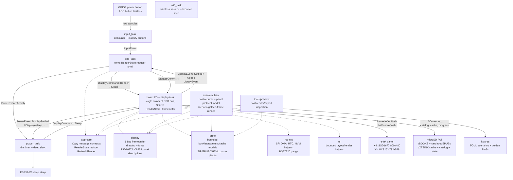

# MarigoldOS architecture

This firmware is a bare-metal Rust reader OS for the Xteink X4 and X3 e-ink
readers: ESP32-C3, monochrome e-paper panels, no PSRAM.

The design goal is not to imitate a desktop OS. It is a small data pipeline:

```text
buttons -> app state -> display command -> framebuffer -> panel RAM -> refresh -> sleep
```

## Current architecture diagram



## Rules

- `#![no_std]`, no heap allocation in the reading path. The one
  exception is the wireless session, which donates loaned buffers to
  esp-alloc and ends in a reset (see "Wireless session").
- Two 1 bpp framebuffers: the one views draw into, and the retained previous
  frame that fast refreshes diff against, which lives at the top of dram2
  (`fw::sync_mem`, placed by `fw/build.rs`). Each is 48 KB on the X4 (52 KB on
  the X3).
- Display ownership is single-writer: only `display_task` touches the EPD bus.
- Reader state ownership is single-writer: only `app_task` mutates page/menu state.
- Messages are small `Copy` values. Bulk bytes stay in caller-owned buffers.
- Power requests display sleep through `display_task`; it never touches SPI.
- Hardware assumptions live in a few places:
  - Board wiring (X4 and X3) in `fw/src/main.rs` and `fw/src/tasks/input.rs`.
  - Panel-controller descriptions in `display/src/epd/`: `ssd1677.rs` (X4) and
    `uc8253.rs` (X3), selected at compile time by the `device-x3` feature.
  - Panel refresh flows in `fw/src/display_flush/`.

## Workspace

```text
app-core/ app state reducer and Copy message contracts shared by firmware/tools
display/   framebuffer, drawing primitives, fonts, SSD1677 (X4) and UC8253 (X3)
           panel descriptions
hal-ext/   thin async wrappers over ESP HAL peripherals
fw/        boot, Embassy executor, task wiring, board-owned peripherals
           (esp-hal 1.1, esp-rtos, and esp-radio, pinned in fw/Cargo.toml)
ui/        shared shell rendering plus ui::reading, the reader page-plan seam
           (page bounds, ink measurement, wrapping) used by fw and host tools
proto/     bounded book/storage/text/cache models plus ZIP/EPUB/XHTML parser pieces
tools/emulator/ host-side development emulator and scenario runner
tools/cargo.sh  rustup Cargo wrapper on the toolchain pinned in rust-toolchain.toml
tools/bench/    serial bench harness for hardware timing, storage/cache,
                sleep, soak, and host channel-stress checks
```

## Embassy tasks

```text
app_task
  owns ReaderState
  InputEvent -> DisplayCommand::Render
  views (AppView): Home, Library, Reading, Chapters, Wireless, Settings,
  FirmwareUpdate

board_io/display task
  owns EpdBus, SD CS, ReaderStore, and Framebuffer
  DisplayCommand::Render -> pure framebuffer render from the current ReaderStore snapshot
  StorageCommand::* -> serialized SD/FAT/catalog/cache work on the shared SPI bus
  DisplayCommand::Sleep -> sleep screen full refresh -> panel deep sleep -> PowerEvent::DisplayAsleep
  sends DisplayEvent::Settled to app_task when render completes

input_task
  polls GPIO3 and ADC ladders
  debounced ADC/power edges -> reader Button actions -> InputEvent

power_task
  observes activity and display-settled events
  asks display_task to sleep the panel, then enters ESP32-C3 deep sleep

wifi_task
  parked until SyncCommand::Start arrives from the Wireless screen
  requests StorageCommand::LoanSyncMemory, receives the dismantled EPUB
  scratch as radio heap, joins Wi-Fi in STA mode, reports SyncEvents to
  app_task, then serves the browser shelf page at the device's LAN address
  SyncCommand::Exit (the done press) ends the session with a software reset
```

## Wireless session

The wireless session is one-way and modal because the radio blob needs ~100 KB of
heap this firmware does not have while reading. `fw::sync_mem` owns the
plumbing: the display task dismantles the EPUB scratch into raw regions
(`reader_cache::dismantle_scratch`), and the wifi task donates two of them to
esp-alloc as heap. The smaller scratch buffers are reused directly as TCP
socket and HTTP buffers. dram2 (the boot-loader shadow segment) holds only the
previous-frame framebuffer, packed against its top so the radio's static
demand fits in main DRAM; `fw/build.rs` hands the gap beneath it to the main
stack, and the trimmed `ControllerConfig` in `fw/src/tasks/wifi.rs` keeps the
radio within the smaller heap. Once loaned, the reader pipeline cannot come
back: leaving the Wireless screen after the radio ran maps to
`SyncCommand::Exit`, which is a software reset; boot restore then reloads the
saved position.

Before the loan the display task flushes any coalesced reading position
to the state record (STATEA/STATEB), because the session's only exit is the
reset. (An earlier iteration also exchanged the position with a kosync
server here; that shipped unused and was removed — the session is purely a
book server.)

Once joined, the wifi task serves a shelf page at the device's LAN
address (the Wireless screen's `Serving` status hands out the URL, with
Confirm as the done key). The
page lists the catalog, shows real upload progress, and offers per-book
removal. Routes: `GET /` serves the page, `GET /list` returns the catalog
snapshot shipped with the loan, `POST /upload?name=` streams raw EPUB
bytes, and `POST /delete?name=` removes a book (card-root entries carry
`root=1`; uploads always land in /BOOKS). Upload bytes reach the display
task — still the single SD owner — through `fw::upload`'s two-buffer
ping-pong: 4 KB chunks carry loaned buffers one way and the buffers come
back on a return channel once written. The display task holds one interruptible
SD session for the upload phase and writes a standard VFAT long name such
as `/BOOKS/Original Name.epub`, backed by a deterministic collision-safe
`.EPU` short alias. Existing long names are rejected without opening or
truncating the original; an alias collision probes another alias instead of
overwriting an unrelated file. Legacy short-only `.EPU` uploads and their
`/XTEINK/LABELS` sidecars remain readable. Power/idle sleep and the done press
abort an active writer, reclaim the incomplete file's FAT chain, close the SD
session, and only then sleep or reset. The boot rescan surfaces new books.

Station credentials come from alternating `/XTEINK/WIFIA.BIN`/`WIFIB.BIN`
generations (written by the onboarding portal below; a legacy `WIFI.BIN` is
still read), falling back to compile-time `option_env!` values
(`XTEINK_WIFI_SSID`/`XTEINK_WIFI_PASS`) for dev builds.
At boot the display task reads the saved credentials once and reports the saved
network's name as `SyncEvent::NetworkSaved`, so the Wireless screen can
show which network is saved and offer connect/forget honestly instead of
guessing from build flags. Forget is a two-press flow (the browse key
arms it, Confirm deletes both generations and any legacy `WIFI.BIN` via
`StorageCommand::ForgetWifiCredentials`) and is only reachable while the
radio is untouched; it drops the screen back to the set-up offer — the
recovery path for a wrong password or a changed router that used to
require editing the card on a computer.

With no credentials anywhere, starting a session raises the onboarding portal
instead: an open `XTEINK-X4` hotspot at 192.168.4.1 with a captive DHCP
server, a DNS catch-all (every name resolves to the portal, which makes
phones raise their sign-in sheet unprompted), and a credential form on
port 80. The Wireless screen shows a baked-at-build-time join QR
(`tools/generate_qr.py`). Submitted credentials travel to the display
task as a `StoreWifiCredentials` Copy message, land on the card, and the
next session joins as a station. `proto::captive` holds the sans-IO
DHCP/DNS/HTTP codecs under host tests; the wifi task only owns sockets.

Embassy is used for cooperative waits: ADC retry delays, button polling, SPI DMA
transfers, BUSY waits, and sleep windows all yield instead of spinning. The real
battery win comes after display settle: the power task asks the display task to
draw a visible sleep screen, power down the panel, then move the ESP32-C3 into
deep sleep. The power button also requests this same sleep path instead of being
treated as ordinary navigation input.

Input/render backpressure is intentionally coalesced. The app keeps at most one
display render in flight. While the display is refreshing, new button events
still update `ReaderState`, but they set a single pending-render flag instead of
queuing stale framebuffer renders. When `DisplayEvent::Settled` arrives, the app
renders the latest state once.

Storage is also explicit. Files/Home/Reading transitions enqueue
`StorageCommand`s; render commands never scan
FAT, open EPUBs, build caches, or write progress. Open/extend requests whose
page already sits inside the loaded section window are answered from RAM
without an SD session. Page turns keep the current panel image until the
storage reply, then render the requested page once. A section already present
in the book index, complete or a prepared prefix, needs only a cache read and
never a loading plate.
Reading-progress writes are coalesced: same-book page turns land at most one
alternating STATEA/STATEB generation per 15 s, and a coalesced position is
written when its window ends even without another page turn, so a battery
pull loses at most 15 s. Book, chapter, and layout changes write at once; a
pending position is also written before display sleep, a Wi-Fi memory loan, a
firmware stage, and a switch to another book. A failed write retries every
30 s. One owner, `ProgressJournal` in the display task, holds these rules.

Sleep always completes. The display task writes the pending position (one
retry), paints the sleep image, powers the panel down, and answers
`DisplayAsleep` even if the write, the refresh, or the power-down failed:
staying awake after a failure only drained the battery, and wake is a reboot
that re-initialises the panel. The power task still deep-sleeps if no answer
arrives within 120 s.
The board I/O task is still
the single SPI owner, so display refresh and SD transactions cannot overlap, but
the user-facing view is always drawn from the latest already-owned snapshot.
SD/FAT access goes through an SD session: the board I/O task deselects the
display, clocks the bus down for the card (400 kHz identification with wake
clocks, then 20 MHz data), opens the FAT root, performs one storage action, and
restores 40 MHz display SPI before returning to EPD work. The card stays powered
between sessions while the device is awake, so only the first session runs the
full CMD0/ACMD41 init; later ones reuse the remembered card type and skip the
handshake, falling back to a cold init if a reused session cannot open the
volume. Deep sleep resets the chip and clears that state.

Settings also exposes a native firmware-file list. Entering it issues a storage
command that scans root-level `.BIN` files into the reader store. After the
second confirmation, the display task draws the visible update handoff, writes
the selected file's FAT alias to `/XTEINK/FWPEND.BIN`, and resets. Boot reopens
that exact source through the existing whole-image validator and inactive-slot
updater. The updater reads the installed ESP-IDF partition table before it
erases anything, because stock X3 units and Marigold/CrossPoint installations
place `ota_1` at different offsets. The source remains on the card so several
firmware images can coexist.

## Display model

`display::fb::Framebuffer` is the source of truth. White is bit `1`, black is
bit `0`, row-major, `ROW_BYTES` per row (100 on the X4, 99 on the X3). Each
framebuffer also carries its `FbFrame`, the drawing frame for how the device
is held (see orientation below).

On the X4, the SSD1677 path writes the current framebuffer to BW RAM
(`0x24`). The first refresh after boot also writes the current framebuffer to
RED RAM (`0x26`) and runs the multi-flash full waveform (~3.5 s), the only mode
that reliably clears unknown pixels. Normal page turns use a second retained framebuffer as the RED
RAM previous-frame source, then trigger the SSD1677 fast waveform (~421 ms).

Between those sits `RefreshMode::FastClean`, the one-flicker clean. On the
SSD1677 it is the display-mode-1 waveform run with the temperature register
overridden to 90 C, selecting the hotter (shorter) OTP LUT — ghost cleanup in
~1.5 s at a small contrast cost. Waking from the sleep screen and view/context changes use it
instead of the full waveform, since the panel's contents are known. After a
FastClean settles, the update sequence reloads the sensed temperature so later
fast refreshes return to sensor-accurate timing.

The X3's UC8253 has two RAM planes (DTM1 "old", DTM2 "new") instead of BW/RED
and has its waveform LUTs uploaded per refresh, so each `RefreshMode` maps to a
LUT bank plus a CDI mode byte; FastClean is a half-scrub LUT bank (see
`display/src/epd/uc8253.rs`).

The user-facing `RefreshPolicy` in Settings selects between `FastOnly` (the
default), `FullOnWake`, and `FullEveryTen` (shown as "clean every ten").
Under `FullEveryTen`, once `DEFAULT_FULL_REFRESH_INTERVAL` (9) consecutive fast
refreshes have accumulated, the refresh planner schedules a cleaning refresh
(FastClean) for the tenth page instead of another fast one. Deep sleep reboots
the chip, so the planner itself does not survive it; `fw::wake_mark` keeps the
one fact that matters in the RTC STORE0 retention register (RTC fast memory is
powered down in deep sleep). The display task sets it when the sleep screen
finishes and consumes it at boot, trusting it only when the reset reason is a
deep-sleep wake. A marked wake seeds the planner as if it had just slept, so
the first paint takes FastClean; `FullOnWake` keeps the deep Full there. A cold
boot, a reset for any other reason, or a sleep whose screen failed paints with
Full.

`display::epd::ssd1677` contains three transform constants currently validated during bring-up:
`MIRROR_X = true`, `MIRROR_Y = false`, and `REVERSE_BITS = true`. The logical
framebuffer API stays upright while firmware and host tools remap bytes/bits
before panel-RAM writes. This fixes the X4 panel's observed horizontal byte
order and bit order without leaking hardware orientation into app rendering.
`MIRROR_Y=true` was tested and rejected because it made glyphs vertically
mirrored/upside down.

Physical orientation is an app/layout concern, not a panel streaming concern.
The reader state carries a four-variant orientation enum:

```rust
enum DisplayOrientation {
    LandscapeButtonsBottom,
    LandscapeButtonsTop,
    PortraitButtonsLeft,
    PortraitButtonsRight,
}
```

Default reader mode is `LandscapeButtonsBottom`. Settings cycles three holds:
the two landscapes and `PortraitButtonsLeft` (front buttons below the screen).
`PortraitButtonsRight` stays in the enum for the persistence format and renders
like `PortraitButtonsLeft`. Renderers draw through `display::fb::FbFrame`
(`Landscape`, `LandscapeFlipped`, `Portrait`, or `Native` for boot and
byte-level tooling): `set_pixel`/`pixel` take upright coordinates in the held
frame and map them onto the panel's native row-major buffer, folding in the
panel's inverted row scan. The low-level display transform above should stay
fixed unless corruption returns.

X4 (SSD1677) addressing follows the OpenX4 community SDK behavior:

- SPI mode 0, 40 MHz.
- BUSY is active high.
- X window is pixel-addressed, `0..799`.
- Y gate scan is reversed, so the full Y window is `479..0`.

## Data-oriented design

State is plain data, not object graphs:

```text
InputEvent        Copy enum
ReaderState       view/book/page/chapter/settings/battery fields
RenderRequest     view/book/page/orientation/refresh/battery/dirty rect
Layout<N>         parallel arrays of kind/rect/parent/text span
Framebuffer       flat byte array plus its drawing frame (FbFrame)
```

`app-core` owns the reader reducer and the shared message contracts. The
firmware `app_task` is an Embassy shell around this pure reducer, and host tools
use the same reducer for deterministic navigation tests. This keeps button flow,
library events, restore events, orientation, refresh policy, and render requests
from drifting between device and emulator.

EPUB work keeps the same shape:

```text
SD file -> ZIP entry -> inflate window -> XML token -> flat cache record -> glyph blit
```

No DOM, no heap object graph, and no entire-book-in-RAM reader model. Parsers
are allowed to be state machines, but their output is immediately flattened into
bounded records.

`proto` owns the reader data contracts shared by Home, Files, Reading, Chapters,
and the host preview tool:

- `BookMeta`, `BookProgress`, and `ChapterMeta` for catalog and progress data.
- `BookStorage` and `FileCandidate` for microSD-backed `.epub` discovery.
- `ZipArchive` for host-side central-directory lookup and stored/deflated entry
  reads into caller-owned buffers.
- `ZipStream` for central-directory lookup and entry reads through a bounded
  `ReadAt` interface, which is the path storage-backed EPUBs use. Firmware ZIP
  reads stream deflate input through a reusable inflater scratch state, so large
  compressed members do not have to fit in the compressed scratch buffer.
- `EpubZipOps` as the narrow zip-entry interface cache loaders program
  against. Both zip front-ends implement it, and one shared streaming inflate
  engine sits behind them, so entry reads behave identically regardless of
  whether compressed bytes come from random-access or forward-only storage.
- `EpubPackage` for OPF metadata, nav/NCX/cover hrefs, and the spine.
  `parse_opf_streamed` reads the package document of any size in two
  streamed passes and copies only the strings the package needs into a 16 KB
  arena. The first pass lays out one 8-byte slot per spine itemref at the
  arena's top, holding a 48-bit hash of its idref; the second fills each slot
  in place as the manifest item with that id streams past (its href span and
  interned media type and properties), so neither manifest ids nor a spine
  table touch the stack. `EpubPackage::spine` is a `Spine` view over those
  slots. A spine past `MAX_SPINE_ITEMS` (1,024), or one whose hrefs exhaust
  the arena, marks the package `spine_truncated`, and the book's last page
  says it was cut short.
- `xhtml_blocks_to_sink` with `TextRole`, `FontStyle`, and `TextAlign` as the
  single XHTML extraction path feeding bounded block records.
- `hyphen::word_breaks` for where a word may break at a line end: the book's
  soft hyphens (the only breaks when present), dashes already in a compound,
  and for English (`dc:language` `en*`), Liang's algorithm over the US English
  TeX patterns (hyph-utf8, generated into flash by
  `tools/generate_hyphenation.py` as a trie whose first two levels are direct
  tables). Two letters stay before a pattern break and
  three after; short words, acronyms, and words with digits or accents stay
  whole.
- `BookV2Header` with `BookV2SectionRecord`, and `SectionV2Header` with
  `PageRecord`, `BlockRecord`, and `TocRecord`, for the bounded binary cache
  records the firmware reads and writes. The earlier `BookCacheHeader`,
  `SectionHeader`, `PageCacheHeader`, `LineRecord`, and `WordRecord` remain in
  `proto::cache` only for the disabled V1 migration path.

The firmware's line builder wraps greedily at word spaces. When a word no
longer fits a justified body line, `ui::reading::worth_hyphenating` decides
whether moving it would leave the line loose (each gap growing by more than
half a space; after two hyphenated lines in a row, by more than a whole
space), and if so the line takes the longest head of the word that fits,
with a hyphen. The word is measured glyph by glyph first (those tables stay
cached, as every word is measured), and the patterns, which are cold by the
time a line ends, are consulted only if a two-letter head fits, and only for
the head that does. On X4 that keeps hyphenation to about a fifth more time
on a cold book build (Death in Venice: 18.9 s without, 24.6 s with), most of
which idle-time preparation (see the reader cache) keeps off the open. A
paragraph's last word is never split, and a word wider than
a whole line breaks wherever it can. At draw time, `justify_extra` leaves a
line at natural spacing rather than open gaps past one and a half spaces, as
well as lines under two thirds of the measure. Soft hyphens survive
normalisation as break hints and are stripped from stored lines.

The firmware still ships one built-in catalog entry as a fallback, but the
board I/O task owns the shared SPI bus while it scans FAT16/FAT32
microSD cards for EPUBs under `/books` and then the card root. X4 SD pins are
configured on the shared SPI bus (SCK GPIO8, MOSI GPIO10, MISO GPIO7, SD CS
GPIO12). SD transactions and display refreshes remain serialized by that single
board-I/O owner.

## SD-backed reader cache

The SD reader shows a book as soon as its V2 cache reaches the requested
page, and prepares the rest while the reader is idle. Preparation runs in
sessions: each opens the package once (ZIP, container, OPF) and lays out
spine items one after another, writing section files as they fill, until the
request is answered, a button is pressed, the book is done, or four seconds
have passed. The book index (a few dozen block writes) is written as the
session ends and every 1.5 s within it, so a press mid-spine loses at most
the spines since. The loading plate stays up only until the cache
holds the requested page (or chapter, or the text start of a first open);
the store is then Ready.

Between sessions the board I/O task keeps only the request and a durable
next-spine cursor, and yields so queued navigation, sleep, and cancellation
can run. A request generation rejects stale work and results after leaving
the book or changing its layout. Within a session a request yields between
spines on a button press; a large XHTML spine still blocks the shared I/O
owner until its stream finishes.

Page numbers are global, so every spine before a page fixes its number. A
request that names a spine well ahead of the prepared prefix (a relaid
book's pinned place, a chapter jump, a first open's text start) does not
wait for them: when at least 64 KB of XHTML lies in between, that spine is
laid out first into a seed run, whose pages are numbered provisionally from
`PROVISIONAL_PAGE_BASE` (0xC000; any page from 0x8000 up is provisional
while a run exists). The run's records follow the prefix's in the book
index, its sections take ids past both banks, and it grows toward later
requests. The prefix then catches up while the reader is idle; layout is
per spine, so it lays the seeded spines out the same, and a provisional
page takes its real number (`ReaderStore::settled_page`) once the prefix
holds its spine. Requests, saved positions, the reader's page (renumbered by
`LibraryEvent::Prepared`), and a later relayout's page pin all translate
through the run, which stays in the index for that. One run per cache
generation, since a second would renumber the first's pages; a spine behind
the run waits for the prefix, and paging back across the run's start shows
the loading plate until it arrives. Books with a generated (headings) TOC,
whose entries follow spine order, are not seeded.

The rest of a Ready cache is prepared by the display task when the reader is
idle: no command for two seconds, the page on screen resident in the layout it
was prepared for, and no sync session. Idle sessions extend the prefix, read
the page on screen back, and yield before the next. They give way at the
next paragraph, or after the OPF parse, once a button press moves
`BUTTON_PRESSES` (the input producers count every press as they queue it, so
the session sees a press the app task has not yet received). The spine in
hand when a session gives way or fails is not committed: the card still
holds what was, and the session reloads the page on screen from it (about
65 ms), so the press is served promptly. On the X4 a cold build of a
1,276-page book costs about 51 ms a page in sessions, against 61 ms with a
package reopen and index write per spine (October 2026). A spine that fails is not retried
until preparation moves on some other way. Growth reaches the app as
`LibraryEvent::Prepared`, which updates page and chapter counts without a
repaint. A reader who outpaces it reaches the prefix's end and gets a
request session with the loading plate.

While a next-spine cursor exists, the cached page count is a known prefix, not
the book's total. An unresolved chapter target stays unresolved rather than
aliasing page zero or the last cached section. Appending complete spines
preserves earlier page numbers and chapter boundaries. Reopening can reuse the
committed prefix (and seed run) after sleep or an interrupted session.

The build covers every spine item from the first (navigation documents
aside), front matter included. It also records where the main text starts:
the OPF guide's `text` (or `start`) reference, else the EPUB 3 nav's
`bodymatter` landmark, else a first spine item named for the cover or title
page. A book with no saved position first opens there, provided the start lies
in the book's first quarter; paging back or the Contents still reach the cover
and foreword. Before layout version 21 the builder dropped everything before
that start instead.

A source spine item can paginate into several sections, and several TOC
chapters can refer to the same spine. The builder closes the current section and opens the next when its in-RAM arena
fills, where the text budget (16 KB) is the binding limit for prose, well ahead
of the block (384) and page (96) caps. Sections are invisible while reading: the
reader walks across them seamlessly, and the footer page-in-chapter counter
aggregates every section sharing a spine. The book index holds up to
`MAX_BOOK_SECTIONS` (1,024 sections, on the order of 14,000 pages of prose;
each spine item takes at least one, so it also bounds books of many short
files). In RAM it is a `SectionTable` of 4 bytes a section, spine and page
count, since ids run contiguously and each section starts where the last one
ended; the card record keeps all 12 bytes. Builds append to the store's table in
place, and index loads fill it directly, so there is one copy. This cap still
applies to the active index. A capacity-limited book becomes terminal and `partial`;
it has no continuation cursor. This differs from a resumable prefix, which has
more source spines available and must not present its known pages as a final
total.

Each section header carries a `font_config` that packs `READER_LAYOUT_VERSION`
with the type size and spacing it was paginated under. A loaded section whose
version or size no longer matches is invalid and forces a rebuild, so bumping
`READER_LAYOUT_VERSION` retires every stale cache after a layout or
cache-encoding change. For a complete, non-partial cache, a spacing-only change streams
all cached pre-wrapped lines through the shared page plan and rewrites the full
book into the other section bank, without reparsing EPUB/XHTML. The section-cut
and carry policy is shared with fresh builds. Only after every replacement
section is written does the new index commit; interruption leaves the previous
generation readable. This full-book spacing reflow is synchronous. A spacing
change to an unfinished prefix takes the fresh-build path instead.

Either way the book's page numbers move, so a page number saved or requested
under the old layout would land somewhere else in the text. Before the old
pagination is replaced, the requested page is pinned as a `PageAnchor`: its
spine item and how far through that spine's pages its middle sat. The spacing
reflow pins it from the resident sections; a rebuild reads the old on-card
index once (`read_v2_page_anchor`, header and section records only) before
building. The pin stays in the `ReaderStore` across the rebuild's steps,
`requested_page` resolves it to the same spot in the new pagination once that
spine is laid out, and the completed load spends it. This covers a type or
orientation change mid-book and opening a book last read under other settings.

Cache paths use FAT 8.3-safe names because `embedded-sdmmc` operates on short
file names in the firmware path. The library list is a windowed catalog
snapshot at `/XTEINK/CATALOG.BIN` (v4: `X4CT` magic, u16 book count, 92-byte
records). Firmware streams it `LIBRARY_WINDOW` (16) entries at a time instead
of holding the whole list in RAM, so library size is bounded by the card, and
only window crossings re-read it. The currently open book sits in a separate
`active_entry` so the reading path never depends on where the list is
scrolled. On boot/refresh, firmware first loads a window from the cached
snapshot, then refreshes `/BOOKS` and card-root discovery in a storage
command, streaming the fresh catalog out in batches without ever holding it
whole. Entries are labeled with the book's real title from its cached index,
falling back to the stored original-filename label for uploaded 8.3-named books,
then to the prettified file stem. This advisory title lookup tries a
source-matching legacy `BOOK.BIN` first to avoid probing absent generation files
for every old catalog entry. Page totals and section loading retain generation
selection. Each fresh catalog write also sweeps `CACHE2` and reclaims caches whose stored source identity no
longer matches any catalogued book, deleting the data files and the emptied
directories while leaving the global state record intact. Files renders the
current snapshot immediately. It shows “reading the card…” until a snapshot or
scan result arrives, “the library is unavailable” when a scan fails with no
snapshot to fall back on, and “no books — add EPUB files to /books” when the
snapshot or a completed scan has no EPUBs.

```text
/XTEINK/CACHE2/E<hash>/BOOKA.BIN
/XTEINK/CACHE2/E<hash>/BOOKB.BIN
/XTEINK/CACHE2/E<hash>/BOOK.BIN       (legacy fallback)
/XTEINK/CACHE2/E<hash>/TOC.BIN
/XTEINK/CACHE2/E<hash>/COVER.BIN
/XTEINK/CACHE2/E<hash>/SECTIONS/S000.BIN
/XTEINK/CACHE2/E<hash>/SECTIONS/S001.BIN
/XTEINK/CACHE2/E<hash>/POSA.BIN       (per-book position, alternating with POSB.BIN)
/XTEINK/CATALOG.BIN
/XTEINK/LABELS/<stem>.TXT
/XTEINK/STATEA.BIN
/XTEINK/STATEB.BIN
/XTEINK/STATE.BIN                     (legacy fallback)
```

Each book index holds a `BookV2Header`, one `BookV2SectionRecord` per section
(spine, start page, page count, partial), TOC records, and title/author/TOC text.
The header also records the optional next-spine cursor, whether the TOC was
generated from content, and the text-start spine (in two formerly reserved
bytes, so older indexes read as "unknown"). `BOOKA.BIN` and `BOOKB.BIN` add a generation/checksum
footer written last. Loading verifies the newest committed body and can fall
back to the older valid generation or legacy index.

Section IDs use two banks, 0–1023 and 1024–2047 (files `S000.BIN` to
`S2047.BIN`). A fresh build or spacing reflow
uses the opposite bank; before overwriting it, firmware retires older indexes
that reference that bank, preserving the active generation. Continuation steps
append unused IDs in the current bank. Thus an interrupted replacement cannot
make a fallback index point into partially overwritten sections. The two banks
provide recovery space, not a doubled active-section limit.

Section files hold a `SectionV2Header`, page records, block records, per-block
paragraph flags, and the UTF-8 text blob of pre-wrapped lines. `TOC.BIN` is a
per-book chapter-list sidecar for the Chapters overview, distinct from the
records inside the book index. Generated TOC metadata is carried across prefix
commits; a missing or stale sidecar can be repaired from the committed index.

The active firmware state keeps only loaded book metadata, the full section index, the active section's page/block records and
text bytes, and small ZIP/XML scratch buffers. Spine XHTML members of any size
stream completely through the resumable block parser in bounded inflate
windows, so chapter content is never truncated by scratch-buffer limits. The
global state record (alternating `STATEA.BIN`/`STATEB.BIN` generations, with a
legacy `STATE.BIN` still read) stores the encoded `AppStateRecord`; version 2
and later records include the SD source size and path-derived hash so boot
restore can map saved progress back onto the scanned SD catalog instead of
trusting a volatile list index. The current version 4 also persists the type
settings (size, spacing, weight, and family) and the front-button order.

`COVER.BIN` is an optional Home-cover sidecar for the same cache key. It stores
a tiny header followed by a 202x303, 1-bit, row-packed bitmap matching the Dock
Clean cover slot. Firmware still loads a valid record into the reader store as
flat DOD data, but the current Home title page does not draw it. The
host preview tool can generate the sidecar from EPUB JPEG/PNG covers with
`--cover-bin` or write it directly to a mounted SD cache path with `--sd-root`.

Reading and chapter navigation typography use generated bitmap assets for two
OFL faces, Literata (the default) and Merriweather, plus an optional SD-card
custom font pack (`docs/CUSTOM_FONTS.md`). `tools/generate_literata.py`
downloads the Literata TTFs and emits glyph metrics/bitmaps for Regular, Italic,
Bold, and BoldItalic covering the ranges in its `RANGES` table: Basic Latin,
Latin-1, Latin Extended-A/B and Additional, Greek, Cyrillic, general
punctuation, currency and letterlike symbols, arrows, and geometric shapes.
Firmware does not rasterize TTFs on-device.

## Development emulator

`tools/emulator` is a host-side parity tool for fast development loops. It has a
headless scenario runner for agents/CI and an optional egui frontend for manual
interactive testing. The default build is headless; the desktop window is built
with `--features gui` to keep routine checks lightweight.

The emulator intentionally models the behavior that is useful during ordinary
development:

- app reducer state transitions from button and library events
- selected-panel 1 bpp framebuffer rendering (X4 800x480 or X3 792x528)
- shared panel byte/bit transform from `display::epd`
- SSD1677-style BW/RED RAM, address counters/ranges, refresh mode history, and
  deep-sleep command validation
- UC8253 DTM1/DTM2, LUT/CDI, prestage, power, and sleep validation driven by
  the same allocation-free refresh-operation plan as firmware
- scripted scenarios that can assert final view/book/page/selection/panel state,
  dump PNG frames, and compare against golden frames

It does not model ESP32-C3 CPU timing, ADC noise, SPI DMA edge cases, BUSY
timings, voltage/temperature behavior, or true e-paper waveform physics. Those
remain hardware-validation concerns.

## Development bench

`tools/bench/bench.py` is the hardware-facing counterpart to the emulator. It
captures serial output with the same DTR/RTS behavior as `tools/serial_capture.py`,
parses structured `bench:` telemetry, writes JSONL logs under `target/bench/`,
and reports timing/storage/sleep summaries. Guided suites use the ordinary
firmware. The default-off `bench-serial` feature additionally exposes button
injection through `tools/bench/send.py`, a two-second deep-sleep timer wake, and
a temporary SD font fixture for repeatable cache measurements. These bench
behaviors are excluded from release builds; see `docs/agents/bench.md`.

Use it in tiers:

- `channel-stress --host` in ordinary development when queue/coalescing,
  refresh-plan, sync-session, reader state, display command, or storage command
  behavior changes.
- short `page-turn` and `sleep-sync` runs before trusting a flashed firmware
  after display, input, sleep, reader rendering, SD session, section cache, or
  progress-write changes.
- longer `reader-soak`, `storage-cache`, and `sleep-sync` runs before releases
  or risky merges.
- `thermal-run` for targeted refresh, ghosting, sleep-screen, enclosure, power,
  SD-card, or ambient-temperature investigations.

Typical commands:

```sh
tools/bench/bench.py channel-stress --host
tools/bench/bench.py page-turn --port /dev/cu.usbmodem101 --turns 50
tools/bench/bench.py storage-cache --port /dev/cu.usbmodem101 --reset-before --seconds 20 --strict
tools/bench/bench.py sleep-sync --port /dev/cu.usbmodem101 --cycles 10
tools/bench/bench.py report target/bench/latest.jsonl
```

Typical development loop (the full gate that CI runs is in
`docs/agents/verification.md`):

```sh
cargo test -p app-core -p proto -p ui --target aarch64-apple-darwin
cargo test --manifest-path tools/emulator/Cargo.toml --target aarch64-apple-darwin --no-default-features
cargo test --manifest-path tools/emulator/Cargo.toml --target aarch64-apple-darwin --no-default-features --features device-x3
cargo run --manifest-path tools/emulator/Cargo.toml --target aarch64-apple-darwin --no-default-features -- --scenario fixtures/scenarios --check fixtures/golden
cargo run --manifest-path tools/emulator/Cargo.toml --target aarch64-apple-darwin --no-default-features -- --scenario fixtures/scenarios --dump target/emulator
cargo run --manifest-path tools/emulator/Cargo.toml --target aarch64-apple-darwin --no-default-features -- --scenario fixtures/scenarios --present-dump target/emulator-presented
cargo run --manifest-path tools/emulator/Cargo.toml --target aarch64-apple-darwin --features gui -- --gui
```

## Web emulator

`tools/web-emulator` compiles the shared crates (`app-core`, `ui`, `display`,
`proto`) to `wasm32-unknown-unknown` behind a small raw C ABI (no
wasm-bindgen). `web/index.html` is a single self-contained page that hosts the
framebuffer on a canvas inside a device mockup, feeds key presses and a
monotonic clock in, and simulates e-ink refresh behavior (fast updates redraw
with ghosting only; fast-clean flickers once; full runs inversion passes).
Reading progress persists in localStorage through the same
`PersistedAppState`/`LibraryEvent::Restored` shape the firmware uses.

Parity boundary: everything rendered by the shared crates tracks firmware
changes automatically. The firmware shell (`fw/`) is not compiled; the wasm
crate carries small stand-ins for it:

- a fake SD layer: eight public-domain books (`SHELF` in
  `tools/web-emulator/src/books.rs`), parsed from
  `tools/web-emulator/books/*.txt` (regenerated by `books/convert.py`) into
  `BlockRecord`s and paginated with the real `ui::reading` walk
- a scripted Wi-Fi session: a join ending at `SyncEvent::Serving`, or the
  onboarding portal when no network is saved
- SD reading-screen composition using the shared `ui::reading` page body,
  page-in-chapter counter, and loading bookplate; the wasm crate supplies its
  own book metadata and storage readiness, and holds the bookplate until the
  loaded typography and page box match the current reader state

Build and deploy:

```sh
cargo build --manifest-path tools/web-emulator/Cargo.toml --target wasm32-unknown-unknown --release
cp tools/web-emulator/target/wasm32-unknown-unknown/release/x4_web_emulator.wasm web/
python3 -m http.server -d web   # local check
```

`.github/workflows/pages.yml` runs the same build, checks the X4 and X3 golden
frames, verifies the web flasher's app-only install contract
(`tools/verify_web_flasher.sh`), and publishes `web/` to GitHub Pages on every
push to main that touches `web/`, the wasm crate, shared crates, or scenario
fixtures. A tagged release dispatches
the Pages workflow with its tag, which copies that release's flash images into
the Pages artifact so the ESP web flasher can fetch same-origin firmware. The
built `.wasm` and release images are gitignored; only sources are committed.

## Reader app model

The firmware now has the e-reader surfaces as explicit app state:

- `Home`: current book title page plus Continue, Library, Wireless, and Settings.
- `Library`: selects a book or opens settings.
- `Reading`: owns the active book/page position.
- `Chapters`: selects a chapter within the current book.
- `Wireless`: the wireless session's connect/forget, onboarding, and shelf
  status screen.
- `Settings`: cycles typeface, font size, type weight, line spacing, refresh
  policy, orientation, and front-button order, and opens `FirmwareUpdate`, the
  SD firmware picker.

Landscape is the default hold: the X4 is held that way for its side page
buttons, and `Home`, `Library`, and `Settings` share the reading posture. The
portrait hold redraws every surface upright through `FbFrame::Portrait`, with
the margin-key labels moved to a row along the bottom edge. Home is a title
page: the current book's title, author, a progress rule, and the chapter name,
with the key labels for Continue, Library, Wireless, and Settings beside it.
Reading mode is full bleed: its only resident furniture is the page-in-chapter
counter. Home shows a small battery percentage because it is a status surface.
On the X4, GPIO0 is sampled as the current rough battery source using a 2:1
divider assumption and a simple 3300-4200 mV LiPo percentage curve; the X3
reads state of charge from its BQ27220 gauge. The current book may be the
built-in fallback or the restored/last-selected microSD EPUB. Home triggers SD scan and
state restore on first render, then `Read` resumes the current EPUB through the
same cache-loading path as Files. If there is no current SD EPUB, `Read` opens
Files when EPUBs are present and falls back to the built-in reader when the card
is empty or unavailable. SD EPUBs use the same flat book/chapter/page fields as
built-in content, but page bodies come from the SD-backed cache instead of
static text arrays.

## Current module map

`fw/src/tasks/display.rs` is intentionally the only task touching the EPD bus and
coordinating SD access. It is now the orchestration layer:

```text
display task orchestration
  receives DisplayCommand
  triggers SD scan and EPUB cache loading when needed
  calls view rendering into the framebuffer
  selects refresh mode
  flushes or sleeps the panel
  publishes display/power/library events
```

The deeper modules keep implementation complexity behind narrow data-oriented
interfaces:

```text
fw::display_flush       panel-plan execution, RAM streaming, BUSY waits, and sleep
fw::library_sd          FAT scan, SD chip-select handling, and file discovery
fw::sd_session          SD session open/close and the upload write pump
fw::reader_cache        EPUB-to-cache loading into bounded proto::cache records
fw::reader_cache_files  cache/state/credential/label file records on the card
ui::reading             Reader page plan: one page walk, wrapping, measurements, drawing
fw::reader_layout       bounded page-index and TOC adapters over the shared page walk
fw::reader_store        bounded loaded-book/library state shared by cache and views
fw::catalog             the built-in fallback book's static content
fw::sync_mem            the one-way memory loan for the Wi-Fi session
fw::upload              browser-to-shelf upload ping-pong plumbing
fw::views               Home/Files/Reading/Chapters/Settings drawing
fw::custom_font         SD-card custom font pack metrics and glyph drawing
fw::firmware_files      root-level firmware image catalog for the Settings picker
fw::ota_update          boot-time SD firmware update, otadata switch, recovery combo
fw::tasks::display      task loop, refresh policy, and event publishing
```

Do not split this by moving bus access into a second task unless there is also a
proper request/response protocol for the shared SPI bus. The current invariant
that display refresh and SD reads cannot overlap is more important than file
size.

Persistent app state is represented by `hal_ext::nvm::AppStateRecord`, a compact
versioned/checksummed record for book id, chapter, rendered screen, shell
orientation, reading orientation, refresh policy, type settings, front-button
order, source hash, and source file size. The firmware stores it on the card as
alternating `/XTEINK/STATEA.BIN`/`STATEB.BIN` generations (legacy `STATE.BIN`
is still read); there is no flash copy.

## Performance

| | |
|---|---|
| Page turn | 473 ms end-to-end; 421 ms of that is the panel's rated fast waveform |
| Wake from sleep | one flicker, ~1.5 s |
| Cold-boot full refresh | 3.5 s |
| Reopen a cached book | tens of milliseconds |
| RAM | 400 KB SRAM, no PSRAM |
| Main stack | linked region about 35.9 KB on X4; the link fails below 27 KB (`fw/build.rs`) |
| Framebuffers | two (current + previous frame), 48 KB each on X4, 1 bit per pixel |

## Bring-up checklist

1. Flash firmware and confirm the reader shell appears.
2. Measure BUSY on GPIO6 during reset and refresh.
3. Confirm full refresh timing.
4. Confirm `TL`, `TR`, `BL`, and `BR` are readable and map consistently.
   Current readable transform: `MIRROR_X=true`, `MIRROR_Y=false`,
   `REVERSE_BITS=true`. Logical top currently appears on the physical button
   side; handle this later through `DisplayOrientation`.
5. Validate the Adafruit-scaled ADC ladder bands against this physical unit.
   Current calibrated bands are GPIO1 Back `2400..2700`, Confirm `1800..2150`,
   Left `1000..1250`, Right `0..100`; GPIO2 Up `1500..1800`, Down `0..100`. Raw
   hardware buttons then pass through a CrossPoint-style mapping layer into
   reader actions: front `BACK_CONFIRM_LEFT_RIGHT`, side `PREV_NEXT`. Both
   previous-page buttons emit `Previous`; both next-page buttons emit `Next`.
   Raw ADC serial logging and on-screen GPIO values are now behind debug
   constants so normal firmware only refreshes on debounced button edges.
6. Measure deep-sleep current.

Storage, saved progress, the wireless session, portrait orientation, and the
FastClean refresh mode have all landed since this checklist was written;
partial-window refresh remains deliberately shelved.
